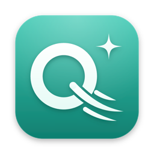
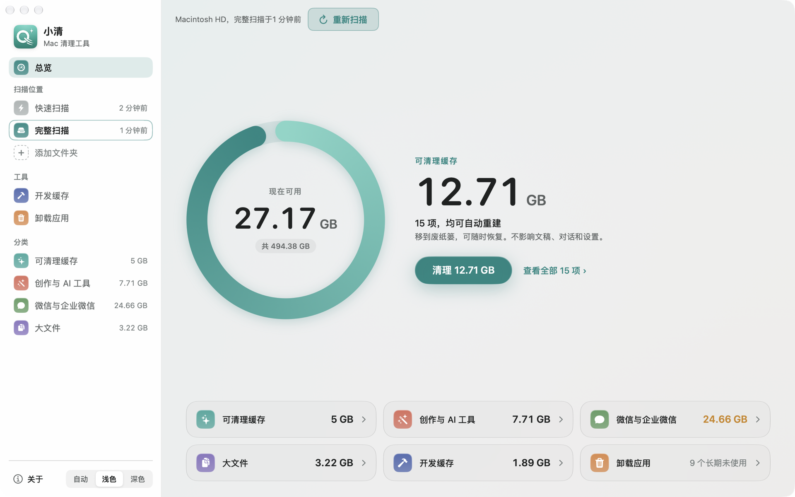
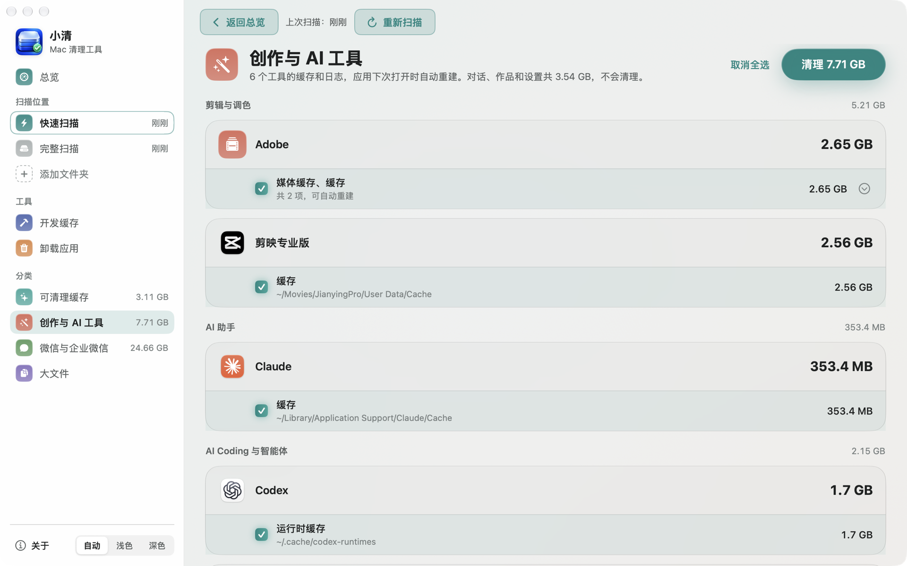
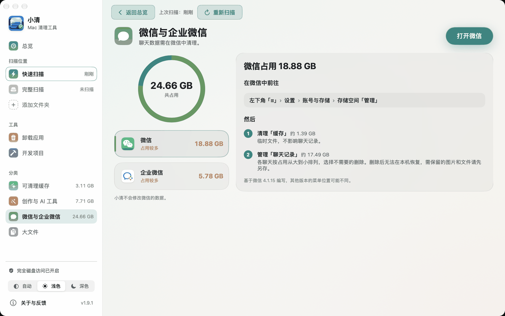
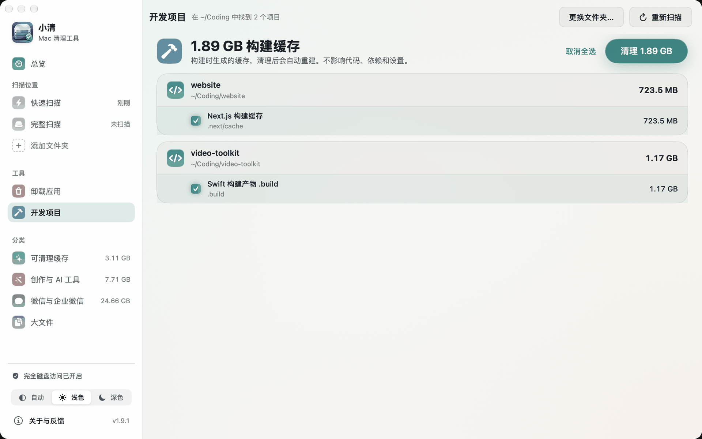
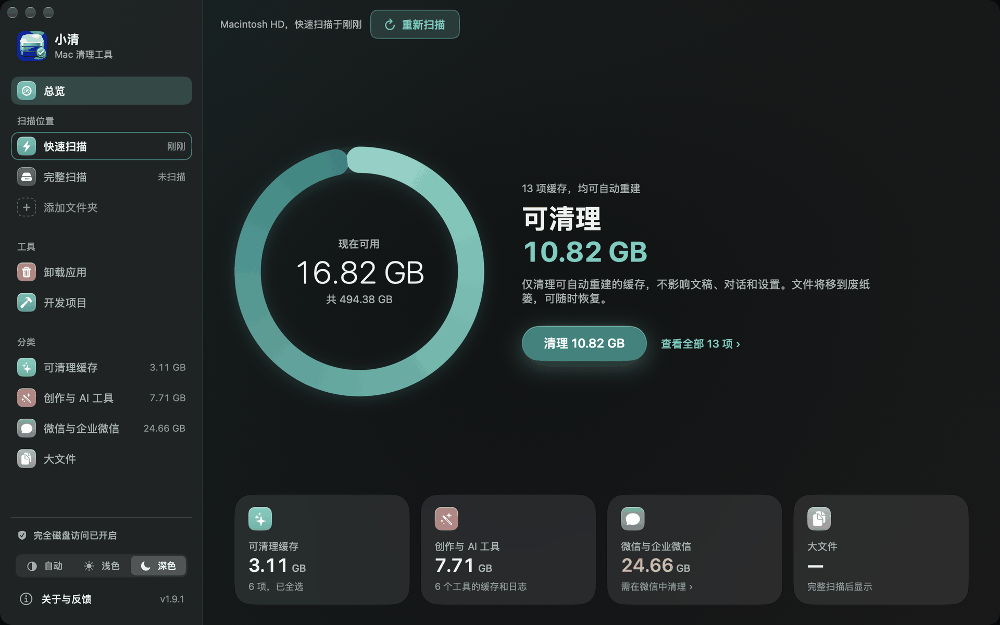
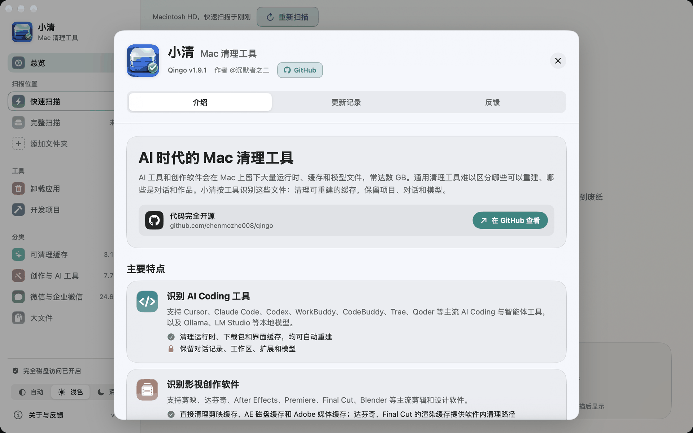

<div align="center">



# 小清：Mac 清理工具

**Qingo**，AI 时代的 Mac 清理工具

面向影视创作者与开发者的 Mac 清理工具。识别剪映、达芬奇、Adobe 系列等剪辑软件，以及 Codex、Claude Code、Cursor 等 AI 工具的缓存，一键清理，不影响项目、素材与对话。

简体中文 | [English](README.en.md)


https://github.com/user-attachments/assets/26e3167a-a583-4903-9a98-c31545a76d3f



</div>

AI 工具和创作软件会在 Mac 上留下大量运行时、缓存和模型文件，常达数 GB。通用清理工具难以区分哪些可以重建、哪些是对话和作品。小清按工具识别这些文件：清理可重建的缓存，保留项目、对话和模型。

原生 SwiftUI 应用，支持浅色 / 深色 / 自动外观；自动模式跟随 macOS 外观设置，macOS 26 上使用系统液态玻璃效果。

## 主要特点

- **识别 AI Coding 工具**：支持 Cursor、Claude Code、Codex、WorkBuddy、CodeBuddy、Trae、Qoder 等主流 AI Coding 与智能体工具，以及 Ollama、LM Studio 等本地模型。清理运行时文件、下载包、界面缓存和日志；保留对话记录、工作区、扩展和模型。
- **识别影视创作软件**：支持剪映、达芬奇、After Effects、Premiere、Final Cut、Blender 等剪辑和设计软件。直接清理剪映缓存、AE 磁盘缓存和 Adobe 媒体缓存；达芬奇、Final Cut 的渲染缓存提供软件内清理路径；保留项目、草稿和素材。
- **一键清理**：只列出可自动重建的缓存，默认全选，点击即清理，软件运行时也可清理。文件移到废纸篓，可撤销；不会自动清空废纸篓。
- **开发缓存**：快速扫描时在后台检查代码文件夹，总览单独显示构建缓存，不并入一键清理；进入「开发缓存」页按项目查看和清理。
- **剩余空间提醒**：可用空间低于 10 GB 时发送系统通知，小清未打开时也会提醒；点按通知即开始快速扫描。可在菜单「小清 › 剩余空间较少时提醒」中关闭。
- **空间变化报告**：可用空间明显减少时，列出与之前的快速扫描相比增加最多的项目及原因，可直接清理；附近几天的可用空间曲线。
- **开源**：清理规则全部在代码中，可供查验。仅在检查更新时访问 GitHub（每天最多一次，可关闭），不上传任何数据，扫描结果仅保存在本机。

## 截图

| 创作与 AI 工具：按工具区分缓存和作品 | 微信与企业微信：显示占用和微信内的清理路径 |
| --- | --- |
|  |  |
| **开发缓存：按项目列出构建缓存** | **深色模式** |
|  |  |

<p align="center"></p>

## 扫描范围

| 分类 | 内容 | 处理方式 |
| --- | --- | --- |
| 可清理缓存 | 应用缓存、npm / pip / uv 等包缓存、更新安装包 | 一键清理，默认全选 |
| 创作与 AI 工具 | 按「剪辑与调色 / 设计与三维 / AI 生图与视频 / AI 助手 / AI Coding 与智能体 / 本地模型」分组 | 只列出可重建的缓存和日志 |
| 微信与企业微信 | 占用大小和微信内的清理路径 | 不删除，仅提供路径 |
| 大文件 | 超过 1 GB 的文件、安装包和项目文件夹（完整扫描） | 文件和安装包需确认后删除，项目文件夹仅显示大小 |

快速扫描只检查常见缓存和已识别工具的目录，通常几秒到几十秒；完整扫描检查整个用户目录。

侧栏「工具」另提供两项功能：

- **开发缓存**：在代码文件夹（默认 `~/Coding`）中按项目列出构建缓存，清理后会自动重建。不影响代码、依赖和虚拟环境。
- **卸载应用**：将应用及其在 `~/Library` 中的支持文件、缓存、偏好设置、窗口状态和后台程序一并移到废纸篓，可撤销。仅在固定目录中按 bundle id 和应用名精确匹配，移除范围包括该应用的对话、模型和设置；不读取、不删除沙盒数据（Containers）。另提供「已删除应用的残留」清理：匹配规则严格，默认全选。

## 支持的工具

| 类别 | 工具 |
| --- | --- |
| 剪辑与调色 | After Effects、Premiere Pro、Media Encoder、Audition、Adobe 媒体缓存、Final Cut Pro、DaVinci Resolve、剪映专业版、CapCut、万兴喵影 Filmora、OBS Studio、Topaz Video |
| 设计与三维 | Photoshop、Illustrator、Lightroom、Figma、Sketch、MasterGo、即时设计、Canva 可画、Blender、Cinema 4D、Houdini、Unreal Engine、Unity |
| AI 生图与视频 | ComfyUI、DiffusionBee、Stable Diffusion WebUI、Fooocus、Pinokio、即梦、MiniMax Design、ArtCraft、AIGC 创作辅助工具 |
| AI 助手 | ChatGPT、Claude、Perplexity、豆包、Kimi、通义千问、腾讯元宝、Cherry Studio、Chatbox |
| AI Coding 与智能体 | Cursor、Windsurf、Trae、Qoder、CodeBuddy、WorkBuddy、Kiro、VS Code、Zed、通义灵码、文心快码、Claude Code、Codex、Gemini CLI、OpenCode、OpenClaw |
| 本地模型 | Ollama、LM Studio、Hugging Face 模型、Jan、GPT4All、PyTorch 模型 |

各工具可清理的目录和受保护的目录见 [`Sources/Qingo/CreativeApps.swift`](Sources/Qingo/CreativeApps.swift)。此外，「可清理缓存」还涵盖浏览器、办公软件等常用应用的缓存，以及 npm、pip、uv 等包管理器的缓存。

## 下载安装

要求：macOS 14 Sonoma 及以上，Apple 芯片（M1 及更新）。

1. 在 [Releases](https://github.com/chenmozhe008/qingo/releases/latest) 下载 `Qingo-<版本>.zip`，双击解压，将「小清」拖到「应用程序」文件夹。
2. 首次打开时，系统会提示无法验证开发者（小清未经 Apple 公证）。打开「系统设置 → 隐私与安全性」，在页面下方点击「仍要打开」，再次确认后即可打开，此后可正常启动。也可以在「终端」中运行以下命令，之后直接双击打开：

   ```
   xattr -dr com.apple.quarantine /Applications/小清.app
   ```
3. 如需扫描微信占用和更多缓存，在「系统设置 → 隐私与安全性 → 完全磁盘访问」中开启「小清」。

## 常见问题

**清理后，可用空间为什么没有变化？**
小清只将文件移到废纸篓，不做永久删除。清空废纸篓后，空间才会释放。

**清理错了，如何恢复？**
清理完成后，可在 15 秒内点击结果条中的「撤销」，将本次清理的文件放回原位置。结果条收起后，也可以在废纸篓中选中文件，右键选择「放回原处」。

**首次打开时，为什么提示「无法验证开发者」？**
小清未经 Apple 公证。代码完全开源，可自行审阅，或从源代码构建。按「下载安装」第 2 步操作即可打开。

**必须开启「完全磁盘访问」吗？**
不是必需的。未开启时，小清仍可扫描常见缓存和大部分工具目录；微信、企业微信等受系统保护的目录无法读取，不计入结果。开启后重新扫描即可显示。

**与通用清理工具有什么区别？**
通用清理工具通常按类别汇总（应用缓存、系统垃圾等），难以区分同一工具目录中哪些是缓存、哪些是对话和作品。小清按工具逐一识别，只列出可自动重建的缓存，逐项注明名称、位置和可清理的原因；清理只移到废纸篓，可撤销。

**小清会联网或上传数据吗？**
不会。小清不包含任何网络请求代码，扫描结果仅保存在本机。

**如何卸载小清？**
退出小清，将「应用程序」中的「小清」移到废纸篓。如需同时移除扫描记录和设置，再删除 `~/Library/Application Support/Qingo` 文件夹和 `~/Library/Preferences/io.github.chenmozhe008.qingo.plist`。

## 从源代码构建

需要 Xcode 或 Swift 命令行工具：

```sh
git clone https://github.com/chenmozhe008/qingo.git
cd qingo
./script/build_and_run.sh --package   # 生成 dist/小清.app
./script/test.sh                      # 运行测试
./script/package_release.sh           # 生成发布用的 tmp/release/Qingo-<版本>.zip
```

本机存在 Apple Development 证书时使用该证书签名，否则自动使用临时签名（ad-hoc）。发布包统一使用临时签名并去除调试符号，不含构建机器的信息。

## 添加工具支持

工具清单在 [`Sources/Qingo/CreativeApps.swift`](Sources/Qingo/CreativeApps.swift)，每个工具对应一条定义，主要字段如下：

- `folders`：该工具在 `~/Library/Application Support` 和 `~/Library/Caches` 下的文件夹名
- `roots`：该工具在用户目录下的数据目录（仅统计，不清理）
- `caches`：可确定自动重建的缓存目录（可清理）

无法确认可重建的路径只应放入 `folders` 或 `roots`，不应放入 `caches`。欢迎提交 Pull Request，请注明路径来源。

## 安全边界

- 扫描只读，不跟随符号链接，不跨卷。
- 只列出可自动重建的内容，默认全选，一键清理；无法确认安全的内容（对话、作品、模型、依赖）不会列出。
- 「大文件」例外：文件和安装包需手动选择并确认；项目文件夹仅显示大小。
- 清理前再次核对文件身份，文件发生变化即跳过。缓存在软件运行时也可清理（软件会自动重建）；大文件正在使用时跳过。
- 清理后可撤销，将文件恢复到原位置。
- 清理只移到废纸篓，不做永久删除。
- 聊天软件数据、凭据目录（`.ssh`、`.aws` 等）、项目文件始终受保护；Xcode 仅清理 DerivedData 构建缓存。

## 反馈

- [GitHub Issues](https://github.com/chenmozhe008/qingo/issues)
- 邮件：327529709@qq.com

更新记录见 [CHANGELOG.md](CHANGELOG.md)。

## 许可证

[MIT](LICENSE) © 沉默者之二

> 小清原名「Mac 清理管家」，1.1.0 起改名。
